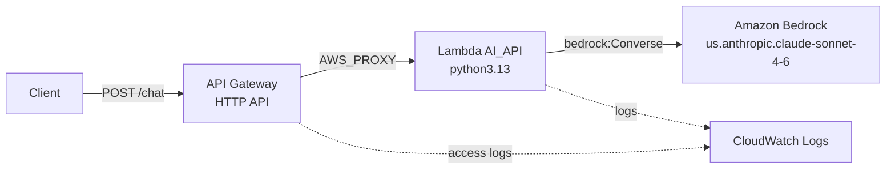

# aws-serverless-ai-api

A serverless HTTP API on AWS that forwards a prompt to an Amazon Bedrock model and returns the model's reply. Infrastructure is defined in Terraform; the function is a single Python file.

## Architecture



- **API Gateway (HTTP API)** `serverless_lambda_gw` exposes one route, `POST /chat`, on the auto-deployed stage `serverless_lambda_stage`. It forwards the request to the Lambda with proxy integration, so the Lambda receives the raw request as `event`.
- **Lambda** `AI_API` (`code/lambda_function.py`) reads `prompt` from the JSON request body, calls the Bedrock Converse API, and returns `{"message": ..., "success": true}`. Failures return HTTP 500 with `error` and `details`.
- **Bedrock** model and region are set in Terraform, not in code: `MODEL_ID` and `BEDROCK_REGION` in the Lambda's environment block (`infra/main.tf`).
- **Deployment packaging:** Terraform zips `code/` into `code.zip` at the repo root, uploads it to a randomly named S3 bucket, and points the Lambda at that object. Any change under `code/` changes the hash and redeploys on the next `terraform apply`.
- **IAM:** the Lambda role has the basic execution policy (CloudWatch Logs) and `bedrock:InvokeModel` / `bedrock:InvokeModelWithResponseStream`.
- **Logs:** Lambda and API Gateway log groups both retain logs for 30 days.

Layout:

```
infra/   Terraform configuration (provider, S3, Lambda, IAM, API Gateway)
code/    Lambda source (lambda_function.py)
code.zip Generated by Terraform; do not edit
```

## Prerequisites

- Terraform `~> 1.2` (the AWS provider is pinned to `~> 6.17.0`)
- AWS CLI, configured with credentials for an account where you can create Lambda, API Gateway, IAM, and S3 resources
- Access to the Bedrock model `us.anthropic.claude-sonnet-4-6` enabled in `us-east-1`. Bedrock model access is a console setting and Terraform does not manage it.

Everything deploys to `us-east-1` (`var.aws_region`).

## Setup and deploy

```bash
cd infra
terraform init
terraform apply
```

Useful outputs after apply:

```bash
terraform output -raw base_url         # https://<id>.execute-api.us-east-1.amazonaws.com/serverless_lambda_stage
terraform output -raw function_name    # AI_API
terraform output -raw lambda_bucket_name
```

To change the model, edit `MODEL_ID` in `infra/main.tf` and run `terraform apply` again.

## Testing the API

Run from `infra/` so `terraform output` can read the state:

```bash
curl -X POST \
  -H "Content-Type: application/json" \
  -d '{"prompt": "Explain briefly what is AWS lambda"}' \
  "$(terraform output -raw base_url)/chat"
```

Expected response (HTTP 200):

```json
{"message": "...model reply...", "success": true}
```

## Invoking the Lambda directly

This bypasses API Gateway. The handler reads the prompt from `body`, which must be a JSON string, the same way API Gateway passes it:

```bash
aws lambda invoke --region us-east-1 \
  --function-name "$(terraform output -raw function_name)" \
  --cli-binary-format raw-in-base64-out \
  --payload '{"body": "{\"prompt\": \"Explain briefly what is AWS lambda\"}"}' \
  response.json && cat response.json
```

A payload without `body` sends a `null` prompt to Bedrock, which fails and returns a 500.

Function logs:

```bash
aws logs tail /aws/lambda/AI_API --region us-east-1 --follow
```

## Tear down

```bash
cd infra
terraform destroy
```

The Lambda code bucket is not configured with `force_destroy`, so `destroy` fails while it still holds `code.zip`. Empty it first with `aws s3 rm s3://$(terraform output -raw lambda_bucket_name) --recursive`, then run `destroy` again.

## Notes

- `infra/terraform.tfstate` is gitignored and no longer tracked. State files can contain sensitive values, so keep it out of git, or move state to a remote backend.
- The IAM policy allows Bedrock invocation on all resources (`Resource = "*"`). Restrict it to the model ARN if you need least privilege.
